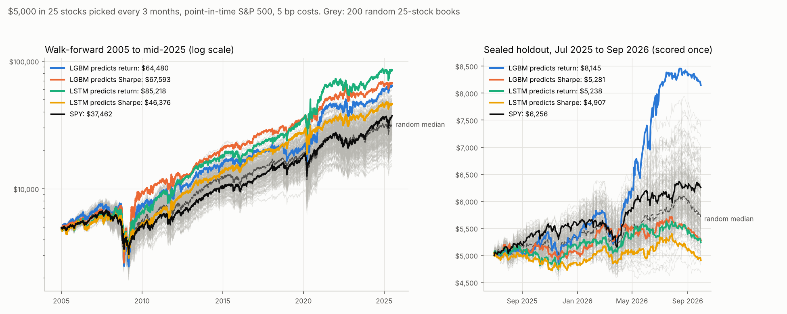

# "My AI stock predictor was lying to me": the video's ideas on our data (2026-11-13)

Paper research only. Joaquin shared the transcript of a YouTube video in which an LSTM picks 25 stocks out of ~500
every 3 months. The video's points: judge by Sharpe ratio, not return; train the model to predict a
volatility-normalised return (Sharpe) instead of the raw return; keep a locked holdout; compare against a cloud of
200 random 25-stock portfolios; and apply Harvey & Liu's "Backtesting" haircut for the number of things tried.
In the video the model lost to the S&P and to the random cloud on the holdout, and the Sharpe target made it worse.

**Short answer.** Same here. Switching the target to Sharpe made both models calmer (beta about 1.0 instead of 1.2
over 2005-2025, about 0.15 in the holdout) but not better: on the sealed 15 months both Sharpe-target books made
-1.5% to +4.5% a year while SPY made 19.6%, and they finished below 86-98% of the random books. One of the four
model books (trees on the raw-return target) did beat SPY on the holdout, +47.8% a year, but that is 1 of 4 tries
over 5 quarters, its edge over SPY has t 1.7 (p 0.09, 0.35 after counting the 4 tries), and a dumb rule (the 25
most volatile stocks) did even better (+66%). Over 2005-2025 no book has an edge over SPY that clears t 1.5.
The haircut and the random cloud change no verdict on our live pots: only Experiment 2's synthetic volatility trade
survives, as before. SPY stays the pick.

## Setup (fixed before anything was run)

- **Universe:** point-in-time S&P 500 (the survivorship fix, PR #38): at each quarter end, the stocks that were
  members that day, delisted ones included (a delisted stock stays at its last price). Sharma ch. 3 (as-was universe).
- **Rebalance:** last trading day of Mar/Jun/Sep/Dec; buy the top 25 by model score, equal weight, hold untouched
  3 months; 5 bp a side on turnover (Sharma ch. 9 for S&P 500 names).
- **Features (22), known at the close:** returns 1/3/6 months, 12-1 momentum, volatility 1/3/12 months, 1-year beta,
  biggest daily gain in the month, distance from 52-week high, 50/200-day average gaps, RSI-14, past-year and
  past-quarter Sharpe, dollar volume and its 1-month/3-month ratio; ranked across stocks each quarter (Coqueret &
  Guida ch. 4). Market mood stand-ins for the video's Fear & Greed index: VIX, its 3-month change, SPY 3-month return.
  We have no 25-year history of news sentiment or insider trades for 500 names, so those two inputs are missing.
- **Targets:** next-quarter return, or next-quarter Sharpe (mean daily return / std of daily returns), both ranked.
- **Models:** LightGBM (refit every quarter, 3 seeds) and an LSTM over the last 4 quarters of features (refit every
  December, 3 seeds). A model used at date d trains only on targets that ended at least 6 months before d (the
  video's gap; Coqueret & Guida ch. 10 on purging).
- **Periods:** walk-forward Jan 2005 - Jun 2025; **sealed holdout Jul 2025 - Sep 2026** (15 months, 5 quarters,
  scored once, no setting changed after seeing it).
- **Benchmarks:** SPY; equal-weight members; 200 random 25-stock books with the same rules and costs; four simple
  rules (25 calmest, 25 best past-year Sharpe, 25 strongest momentum, 25 wildest).

## Results: $5,000 start

**Walk-forward Jan 2005 - Jun 2025** (random 200: median $31,941, 5-95% $20,400-46,556; median Sharpe 0.45)

| book | $5,000 -> | per year | Sharpe | worst drop | beta | alpha vs SPY | t | beats % of random ($ / Sharpe) |
|---|---|---|---|---|---|---|---|---|
| LGBM predicts return | 64,480 | 13.3% | 0.52 | -68% | 1.21 | +2.8% | 0.8 | 100 / 89 |
| LGBM predicts Sharpe | 67,593 | 13.6% | 0.58 | -64% | 1.01 | +3.8% | 1.2 | 100 / 100 |
| LSTM predicts return | 85,218 | 14.9% | 0.59 | -58% | 1.19 | +3.9% | 1.4 | 100 / 100 |
| LSTM predicts Sharpe | 46,376 | 11.5% | 0.52 | -55% | 1.01 | +1.7% | 0.7 | 94 / 88 |
| Rule: 25 calmest | 33,264 | 9.7% | 0.60 | -34% | 0.57 | +2.9% | 1.4 | 57 / 100 |
| Rule: 25 best past Sharpe | 16,127 | 5.9% | 0.30 | -64% | 0.92 | -2.9% | -1.1 | 1 / 1 |
| Equal-weight members | 35,692 | 10.1% | 0.49 | -59% | 1.04 | -0.3% | -0.3 | 68 / 73 |
| SPY | 37,462 | 10.3% | 0.52 | -55% | 1.00 | | | 74 / 89 |

**Sealed holdout Jul 2025 - Sep 2026** (random 200: median $5,677, 5-95% $5,073-6,710; median Sharpe 0.57)

| book | $5,000 -> | per year | Sharpe | worst drop | beta | alpha vs SPY | t | beats % of random ($ / Sharpe) |
|---|---|---|---|---|---|---|---|---|
| LGBM predicts return | 8,145 | 47.8% | 1.93 | -11% | 1.06 | +21.3% | 1.7 | 100 / 100 |
| LGBM predicts Sharpe | 5,281 | 4.5% | 0.11 | -8% | 0.12 | -0.7% | -0.1 | 14 / 14 |
| LSTM predicts return | 5,238 | 3.8% | 0.06 | -9% | 0.57 | -7.7% | -0.9 | 11 / 11 |
| LSTM predicts Sharpe | 4,907 | -1.5% | -0.45 | -9% | 0.18 | -7.4% | -0.8 | 2 / 1 |
| Rule: 25 calmest | 4,990 | -0.2% | -0.28 | -11% | -0.07 | -2.2% | -0.2 | 3 / 2 |
| Rule: 25 wildest | 9,435 | 66.2% | 1.50 | -25% | 2.23 | +20.2% | 1.1 | 100 / 96 |
| Equal-weight members | 5,843 | 13.3% | 0.82 | -8% | 0.70 | -1.0% | -0.2 | 60 / 68 |
| SPY | 6,256 | 19.6% | 1.22 | -9% | 1.00 | | | 85 / 90 |

Full table (including the momentum rule and the whole 2005-2026 period) in `results/backtest.txt`.

How well the scores rank stocks (rank correlation with next quarter's return, average per quarter, 2005-2025):
LGBM return 0.028 (t 1.4), LGBM Sharpe 0.033 (t 1.8), LSTM return 0.044 (t 2.8), LSTM Sharpe 0.026 (t 1.2).
In the holdout all four are about zero (-0.05 to +0.005).

## What this says

1. **The Sharpe target does not help.** Asking the model for "return per unit of risk" mostly teaches it to pick calm
   stocks (its beta falls to ~1.0, and to ~0.15 in the holdout; it behaves like the "25 calmest" rule). Calm stocks
   lag in a strong market, which is what the holdout was. Over 20 years it gave the same Sharpe as the return target,
   not a better one. The rule "buy last year's best-Sharpe stocks" is the worst book in the study.
2. **"Beats the random cloud" is not "has an edge".** Every model book beat 100% of random books on money over
   2005-2025, yet none beat SPY by a significant margin: random equal-weight books simply lagged the cap-weighted
   index after 2015 (the mega-caps). Beating the cloud on money is also easy with more market exposure (the wildest-25
   rule beats 100% of random books in the holdout with beta 2.2). Compare at the same risk (alpha, Sharpe), and against
   SPY.
3. **The one holdout winner is what Harvey & Liu warn about.** Trees on the return target made +47.8% a year in the
   holdout, but it was one of four books, the margin over SPY is t 1.7 over 5 quarters (p 0.09; 0.35 after a
   4-try correction; nothing left after the ~300 strategies this project has tried), its own ranking skill in the
   holdout was zero (rank correlation 0.005), and the gain came in one burst in Apr-Jun 2026 when volatile stocks
   ran (the wildest-25 rule made +66%).
4. **Our live pots after the haircut** (`haircut.py`, pot replays after the survivorship fix, Jan 2019 - Oct 2026):
   Harvey-Liu haircut (BHY method) of each pot's edge over SPY at the same beta, counting ~300 tries:

   | pot | Sharpe | edge over SPY (info ratio) | after haircut, M=300 |
   |---|---|---|---|
   | Exp2 (synthetic variance swap) | 1.88 | 1.96 | **1.41** |
   | Best ideas | 0.99 | 0.66 | 0 |
   | Pelosi copy | 0.93 | 0.52 | 0 |
   | Conviction | 0.85 | 0.34 | 0 |
   | Weekly reversal | 0.59 | 0.00 | 0 |
   | Exp7 VWAP+EMA | 0.06 | 0.01 | 0 |
   | Trend | -0.07 | -0.27 | 0 |
   | Exp1 | -0.29 | -0.32 | 0 |

   Only Exp2 survives, and it is the synthetic version (the tradeable VIX-futures version had t 2.4 in the edge tests,
   which would not survive either). Same verdict as the edge tests and the November audit.
   **Random cloud for the weekly reversal pot** (200 books of 20 random members rebuilt weekly, 1 bp, 2019-2026):
   reversal x3.71 beats 100% of them on money but only 68% on Sharpe (it carries beta ~1.4), and SPY did x3.44
   with a better Sharpe (0.78 vs 0.59).

## Limits

- No news sentiment, Fear & Greed or insider history (VIX and market return stand in); Sharma ch. 11 finds sentiment
  helps only when slowed down, and our own news tests (PR #47) found headline direction only on 8% days.
- Delisted stocks are held at their last price, which flatters books that hold failures.
- 5 holdout quarters is short: even a real edge of Sharpe 0.5 would need ~16 years to show t 2.
- One fixed setup per model, no tuning. That is deliberate (the video's point), and it means a different setup could
  look better or worse by chance.

## Files

| file | what |
|---|---|
| `panel.py` | builds the quarterly point-in-time panel (features + both targets) and the daily return matrix |
| `models.py` | walk-forward LightGBM and LSTM forecasts for both targets |
| `backtest.py` | the 25-stock books, rules, equal weight, SPY, 200 random books, rank IC |
| `haircut.py` | Harvey-Liu haircut on the live pots, random cloud for the weekly reversal pot |
| `stats.py` | performance, Newey-West alpha, Harvey-Liu haircut |
| `chart.py` | the chart above |
| `results/` | `backtest.txt`, `results.json`, `haircut.txt`, `haircut.json`, `books_daily.csv`, `chart.png` |

Run: download the `papers-data` release (point-in-time members and prices), then
`python panel.py <papers_data> <out>`, `python models.py <out> lgbm`, `python models.py <out> lstm` (needs
lightgbm and torch; run them one after the other, not at once), `python backtest.py <out> <papers_data>`,
`python haircut.py <out> <papers_data> research/audit_2026_11/inputs/returns_pit.csv` (from PR #49),
`python chart.py <out> results/chart.png`. About 8 minutes on 4 cores.

References: Harvey & Liu, "Backtesting", Journal of Portfolio Management 2015; Sharma, *The Quantamental Revolution*,
ch. 3 and 9; Coqueret & Guida, *Machine Learning for Factor Investing*, ch. 4, 10 and 12 (backtest overfitting).
